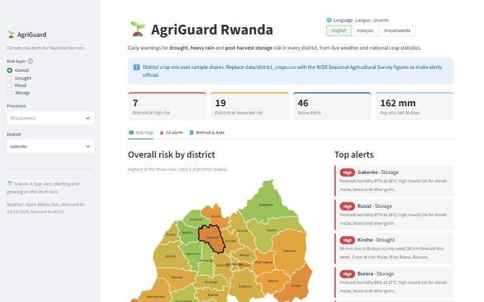
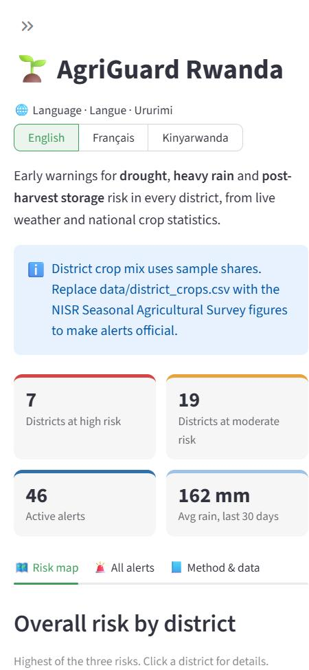

# 🌱 AgriGuard Rwanda

**Climate risk alerts for Rwandan agriculture.** Hackathon Track 1: Agricultural Productivity.

AgriGuard combines live weather data with national crop statistics from the National
Institute of Statistics of Rwanda (NISR). It warns farmers, extension officers and
policymakers, district by district, about three risks:

| Risk | What it means for farmers | Signal used |
|---|---|---|
| 🌵 **Drought / irrigation need** | Rainfall over the last 30 days is not meeting what the district's crops need | Rainfall vs crop water demand (FAO-56) |
| 🌧️ **Heavy rain / flooding** | Heavy rain is forecast that can damage terraces, marshland plots and crops ready to harvest | 6-day rainfall forecast |
| 🌽 **Post-harvest storage** | Humid, warm weeks raise mould and aflatoxin risk in stored maize, beans and other grain | Forecast humidity and temperature |

🔗 **Live app:** **https://sandwich808-yum.github.io/AgriGuard/** (first load takes about 20 seconds)

<p align="center">
  
  &nbsp;
  
</p>

---

## Features

- **Interactive risk map of all 30 districts**, coloured by overall, drought, flood or
  storage risk. Click a district to see its details.
- **Top alerts panel** ranking the most urgent warnings in the country.
- **District drill-down**: daily rainfall (30 days observed plus 6-day forecast) against
  crop water demand, each crop's share of the district's farmland, how much of each crop's
  water need was met, and its drought risk.
- **Recommended actions** for every alert (irrigate, mulch, clear drainage, dry grain,
  use hermetic bags, and so on).
- **SMS alert preview**: each alert is also written as a short text message, ready for
  an SMS gateway so farmers with basic phones can receive it.
- **Three languages: English, Français and Kinyarwanda.** The switcher at the top of the
  sidebar translates the whole interface, including alerts, recommended actions and SMS text
  (`agriguard/i18n.py`).
- **Filters** by province, risk type and level, plus **CSV export** of all alerts for
  district agronomists and the Ministry of Agriculture (MINAGRI) / Rwanda Agriculture Board (RAB).
- **Works offline for demos**: if the weather API is unreachable, the app falls back to a
  saved weather snapshot and says so on screen.

## How it works

```
Open-Meteo API ──► 30 days observed + 6-day forecast, per district centroid
                     (rain, temperature, humidity, ET₀)
                               │
NISR crop area by district ────┼──► Risk engine (agriguard/risk.py) ──► Alerts + map
FAO-56 crop coefficients ──────┘        drought · flood · storage
```

1. **District points**: centroids are computed from the official district boundaries
   (`agriguard/data.py`).
2. **Weather**: a single Open-Meteo request returns daily rainfall, temperature,
   relative humidity and FAO-56 reference evapotranspiration (ET₀) for all 30 districts.
   It is cached for 3 hours (`agriguard/weather.py`).
3. **Drought risk**: for each crop in each district:
   - crop water demand = ET₀ × crop coefficient Kc (FAO-56)
   - water need met = 0.8 × rainfall ÷ demand (80% of rain is treated as effective)
   - risk index = 100 × (1 − water need met). Drought-tolerant crops (cassava, sorghum,
     sweet potato) are scaled by 0.7, and a dry 6-day forecast adds 15 points.
   - the district index is the average across crops, weighted by NISR crop area.
4. **Flood risk**: High at 40 mm in one day or 80 mm over the forecast week.
5. **Storage risk**: applies only where grain or pulses are grown. Moderate above 80% mean
   humidity, High above 85%, increased by 20% in warm (22 °C or more) lowland districts.
6. **Levels**: risk index ≥ 50 is **High**, ≥ 25 is **Moderate**, otherwise Low.

**Why rules and not a black-box model?** Every alert must be explainable to a farmer in one
sentence ("88 mm of rain in 30 days, your maize needed about 175 mm"). The rules use
published agronomic standards (FAO-56), so they work in all 30 districts from day one,
without years of labelled yield-loss data. The design leaves room for an ML model later
(see Roadmap).

## Data sources

| Data | Source | Licence |
|---|---|---|
| Crop area by district | **NISR Seasonal Agricultural Survey (SAS)**, [statistics.gov.rw](https://www.statistics.gov.rw) / [microdata.statistics.gov.rw](https://microdata.statistics.gov.rw) | NISR terms of use |
| Daily weather, forecast and ET₀ | [Open-Meteo](https://open-meteo.com) forecast API | CC BY 4.0 |
| District boundaries (ADM2) | [geoBoundaries](https://www.geoboundaries.org), from Open Data Rwanda | CC BY 4.0 |
| Crop coefficients (Kc) | FAO Irrigation and Drainage Paper No. 56 | n/a |

> ⚠️ **Status of the crop data:** `data/district_crops.csv` currently holds **sample shares**
> (rows marked `SAMPLE`). They are indicative only and were not taken from NISR tables.
> Replace them with the area per crop and district from the latest NISR Seasonal Agricultural
> Survey before final submission. Keep the same columns: `district,crop,area,source`. `area` can
> be hectares or percent, because the app normalises it per district. Once no row says
> `SAMPLE`, the on-screen notice disappears.

## Run it locally

```bash
pip install -r requirements.txt
streamlit run app.py
```

Then open http://localhost:8501.

Run the tests:

```bash
python -m pytest
```

Refresh the offline weather snapshot (do this just before submitting):

```bash
python -m agriguard.weather
```

## Deployment

The live app is hosted free on **GitHub Pages**. `index.html` loads
[stlite](https://github.com/whitphx/stlite), which runs the same Streamlit `app.py` in the
visitor's browser through WebAssembly (Pyodide). There's no server to keep running, and it
needs no API keys or secrets. Weather is fetched live from Open-Meteo by the browser.

To publish your own copy: push the repo to GitHub, then go to **Settings → Pages**, choose
**Deploy from a branch**, pick `main` and `/ (root)`, and save.

The same code also deploys unchanged to a normal Streamlit server. For example, on
[Streamlit Community Cloud](https://share.streamlit.io): **Create app**, choose this repo,
branch `main`, file `app.py`.

## Project structure

```
app.py                     Streamlit dashboard
index.html                 Browser-only launcher for GitHub Pages (stlite)
agriguard/data.py          Boundaries, district centroids, crop tables
agriguard/weather.py       Open-Meteo client + offline snapshot
agriguard/risk.py          Risk rules, district scoring, alert text
agriguard/i18n.py          English, French and Kinyarwanda text
data/district_crops.csv    Crop area by district (NISR SAS format)
data/crops.csv             Crop coefficients and storage guidance
data/rwanda_districts.geojson   District boundaries
data/weather_snapshot.csv  Fallback weather data
tests/test_risk.py         Unit tests
```

## Potential impact

- **Farmers**: a timely SMS such as "irrigate now" or "dry your maize before storing" can
  protect yields and cut post-harvest losses, which FAO estimates at a large share of
  grain in East Africa.
- **Extension officers and cooperatives**: a ranked weekly list of districts and crops
  that need attention, instead of reacting after damage is reported.
- **Policymakers (MINAGRI, RAB, districts)**: one national view that links climate signals
  to crop exposure. It can help target small-scale irrigation, drying equipment and
  hermetic storage bags where they are needed most, and shows the value of NISR survey data
  when it is combined with real-time data.

## Limitations

- Weather is taken at one point per district. Large or hilly districts vary internally.
- Thresholds are based on agronomic standards, not yet calibrated against observed Rwandan
  yield losses.
- Rainfall-based drought risk does not account for land that is already irrigated.

## Roadmap

- Calibrate thresholds, or train a lightweight model (for example gradient boosting), using
  historical NISR SAS yields per district and season against past weather.
- Sector-level detail and satellite soil moisture or vegetation index (NDVI) data.
- Review of the Kinyarwanda and French text with farmers and extension officers.
- SMS gateway integration (for example Africa's Talking).
- Farmer subscription by district and crop.

## AI disclosure

As the competition rules require, we disclose that **AI tools were used** in building this
project. We used **Claude (Anthropic), via Claude Code**, to help write the application code,
tests and this README, to propose the risk-rule structure, and to draft the French and
Kinyarwanda translations. The team reviewed, tested and
adapted all generated output, chose the data sources and thresholds, and takes full
responsibility for the submitted work.

## License

Code: MIT (see [LICENSE](LICENSE)). Data keeps its own licence: Open-Meteo and geoBoundaries
are CC BY 4.0, and NISR data follows NISR's terms of use.

## Team

- **Mhad Magdy**: Team Leader
- **Mohammed Ismail**: Team Member
